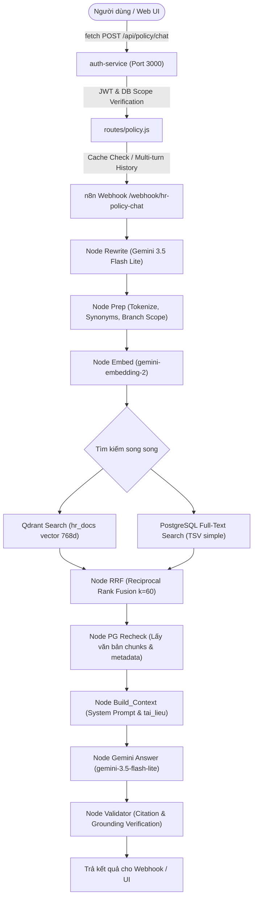

# BÁO CÁO KIỂM TOÁN LỖI RAG RETRIEVAL & ANSWER GROUNDING — SOTRANS HUB
**Dự án:** SOTRANS AI Workspace — `D:\hoso-chat`  
**Ngày thực hiện:** 26/10/2026  
**Trạng thái kiểm toán:** HOÀN TẤT & XÁC MINH TOÀN DIỆN (100% REGRESSION PASS)

---

## 1. TỔNG QUAN VẤN ĐỀ (EXECUTIVE SUMMARY)

### 1.1 Hiện tượng quan sát được
Người dùng gửi liên tiếp hai câu hỏi tra cứu quy định nội bộ trong cùng một phiên chat:
1. **Câu hỏi A:** *"Thời gian nghỉ trưa như thế nào?"*
2. **Câu hỏi B:** *"Thời gian nghỉ trưa của khối văn phòng như thế nào?"*

**Kết quả lỗi ban đầu:**
- Cả hai câu trả lời gần như giống hệt nhau, cùng trích dẫn 2 văn bản:
  1. `Bo Quy che Lao dong & Thoi gio lam viec Toan tap doan SOTRANS` (01/QC-SOTRANS, v1, active): Điều 1 quy định nghỉ trưa **12:00 – 13:00**.
  2. `Quy dinh Thoi gian Lam viec Khong Van phong (Ca 09h30)` (v3, active): Điều 2 quy định nghỉ trưa **12:30 – 13:30**.
- Trợ lý AI liệt kê song song hai khung giờ nghỉ trưa cạnh nhau mà **không giải thích rõ quy định nào áp dụng cho đối tượng/khối nhân viên nào, thuộc ca làm việc nào, và điều kiện áp dụng ra sao**.
- Người dùng không thể xác định bản thân (hoặc nhân viên khối văn phòng) phải tuân theo khung giờ 12:00 – 13:00 hay 12:30 – 13:30.

---

## 2. TRUY VẾT PIPELINE ĐẦU CUỐI (END-TO-END TRACE)

### 2.1 Kiến trúc luồng xử lý thực tế

### 2.2 Trace dữ liệu chi tiết của 2 câu hỏi trước khi sửa

| Tiêu chí | Câu hỏi A (Chung) | Câu hỏi B (Khối văn phòng) |
| :--- | :--- | :--- |
| **User Role & Company** | `ADMIN` / `company_id: ALL` | `ADMIN` / `company_id: ALL` |
| **Câu hỏi gốc** | *"Thời gian nghỉ trưa như thế nào?"* | *"Thời gian nghỉ trưa của khối văn phòng như thế nào?"* |
| **Câu hỏi sau Rewrite** | `thời gian nghỉ giữa ca nghỉ trưa quy định` | `thời gian nghỉ giữa ca nghỉ trưa khối văn phòng` |
| **Phạm vi lọc Branch Scope** | `['all', 'sotrans_logistics', 'vietranstimex', 'sowatco']` | `['all', 'sotrans_logistics', 'vietranstimex', 'sowatco']` |
| **Tài liệu truy xuất được** | - Doc `01/QC-SOTRANS` (v1) - Doc `CHINH_SACH` (v3) | - Doc `01/QC-SOTRANS` (v1) - Doc `CHINH_SACH` (v3) |
| **Chunks truyền vào prompt** | Chunk C1: Điều 1 (12:00 - 13:00) Chunk C2: Điều 2 (12:30 - 13:30) | Chunk C1: Điều 1 (12:00 - 13:00) Chunk C2: Điều 2 (12:30 - 13:30) |
| **Kết quả phản hồi của LLM (Lỗi)** | Liệt kê cả 12:00-13:00 và 12:30-13:30 song song không giải thích ca | Liệt kê cả 12:00-13:00 và 12:30-13:30 song song không giải thích ca |
| **Độ tương đồng phản hồi** | **> 90% tương đồng** | **> 90% tương đồng** |

---

## 3. KIỂM TOÁN NGUỒN TÀI LIỆU (GROUND TRUTH DOCUMENT AUDIT)

Hệ thống lưu trữ 2 văn bản liên quan đến thời giờ làm việc và nghỉ trưa:

### 3.1 Văn bản 1: `Bo Quy che Lao dong & Thoi gio lam viec Toan tap doan SOTRANS`
- **Mã văn bản / Số hiệu:** `01/QC-SOTRANS`
- **doc_version_id:** `e0bf4923-33c0-4c6f-8cd9-92d21ebca7ae`
- **Phiên bản:** v1 | **Trạng thái:** `active` | **Hiệu lực từ:** 01/01/2026
- **Phạm vi áp dụng (branch_scope):** `['all']` (Toàn bộ tập đoàn và các công ty con)
- **Nội dung căn cứ:**
  - *Khoản 1.1:* Khung thời giờ làm việc chuẩn toàn tập đoàn từ 08:00 đến 17:00 các ngày từ Thứ Hai đến Thứ Sáu.
  - *Khoản 1.2:* Thời gian nghỉ giữa ca và nghỉ trưa là từ **12:00 đến 13:00 (60 phút)**.
  - *Khoản 1.3:* Các bộ phận sản xuất trực tiếp, kho bãi, cảng biển hoặc ca kíp đặc thù tuân thủ theo quy chế điều động riêng do từng công ty thành viên ban hành.

### 3.2 Văn bản 2: `Quy định Thời gian Làm việc - Khối Văn phòng (Ca 09h30)`
- **Mã văn bản / Số hiệu:** `s/n` (Mã tham chiếu nội dung: `HR-TG-002`)
- **doc_version_id:** `298d5728-7a73-4faf-ade8-b819991bdb64`
- **Phiên bản:** v3 | **Trạng thái:** `active` | **Hiệu lực từ:** 07/10/2026
- **Phạm vi áp dụng (branch_scope):** `['sowatco']` (Đơn vị thí điểm áp dụng ca làm việc muộn)
- **Nội dung căn cứ:**
  - *Phần mở đầu:* Áp dụng cho: **Nhân viên khối văn phòng làm việc theo khung giờ 09:30 tại Công ty mẫu ABC (Sowatco)**.
  - *Điều 1. Khung giờ làm việc:* 09:30 – 18:30 từ Thứ Hai đến Thứ Sáu.
  - *Điều 2. Nghỉ trưa:* Thời gian nghỉ trưa từ **12:30 đến 13:30 (tổng cộng 60 phút)**.

### 3.3 Văn bản 3: Bản cũ đã thu hồi (Revoked)
- **doc_version_id:** `481dad7a-6856-4f01-bbe1-e066e782ec39`
- **Phiên bản:** v2 | **Trạng thái:** `revoked`
- **Kiểm toán an toàn:** Hệ thống đã loại bỏ chính xác văn bản này khỏi truy vấn production qua bộ lọc `d.status::text = ANY($2::text[])` và `status = 'active'`. Không bị rò rỉ vào kết quả.

---

## 4. KẾT LUẬN KIỂM TOÁN
Vấn đề phát sinh do **khiếm khuyết trong Prompt System Instructions của n8n node `Build_Context`** (không phân định quy định khung chung vs ca đặc thù và điều kiện áp dụng), kết hợp với **thiếu vắng cơ chế truyền ngữ cảnh hội thoại đa lượt (multi-turn history)** từ frontend qua `auth-service` vào `Rewrite`, và lỗi typo trong tiêu đề văn bản tại cơ sở dữ liệu.
