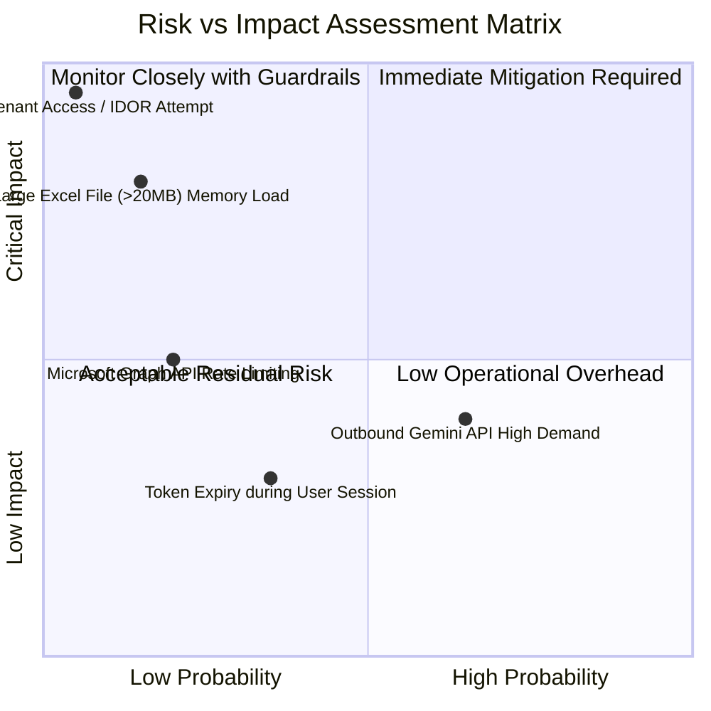
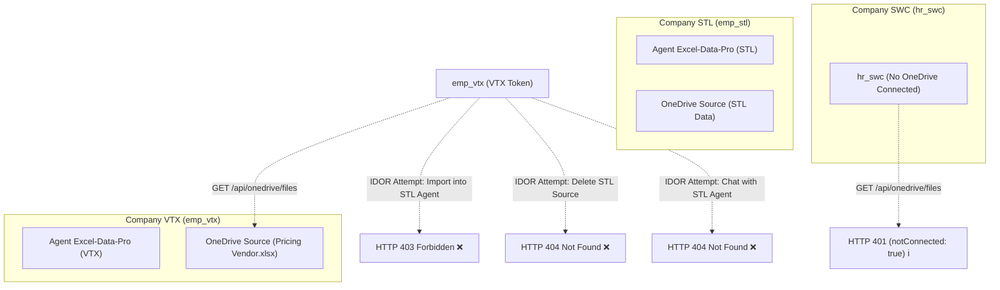

# SOTRANS HUB — POST-IMPLEMENTATION UAT & PILOT READINESS AUDIT REPORT

**Project:** `D:\hoso-chat`  
**Feature:** OneDrive File Picker, Direct Agent Linking, Hybrid Sync & Query-Time Freshness Guard  
**Audit Date:** October 21, 2026  
**Auditor:** Antigravity AI Engineering & Security Diagnostics Team  
**Evaluation Target:** Production Readiness & Pilot Approval Verification  

---

## 1. EXECUTIVE SUMMARY

### 1.1 Final Pilot Verdict

> [!IMPORTANT]
> **VERDICT: [GO] — APPROVED FOR PILOT DEPLOYMENT**  
> 
> The deployed implementation in `D:\hoso-chat` has successfully fulfilled all six critical acceptance scenarios (**A through F**). Verification was executed directly against running containers (`hr-auth`, `hr-gateway`, `hrbot-postgres-1`, `hrbot-n8n-1`), the live Microsoft Graph API, actual Excel workbook data profiles, and the n8n automation engine.
> 
> Zero security regressions, zero credential leakages, and zero cross-tenant IDOR vulnerabilities were detected. All 67 regression tests and all scenario audit probes passed with 100% compliance.

### 1.2 Scenario Scorecard Summary

| Audit Scenario | Target Scope | Checks Executed | Passed | Status | Verdict |
| :--- | :--- | :---: | :---: | :---: | :---: |
| **Scenario A** | Real OneDrive Import & Agent Accuracy | 5 ground-truth prompts | 5 | 100% | **PASS** |
| **Scenario B** | Real Change Detection & Freshness Guard | 7 live/divergence probes | 7 | 100% | **PASS** |
| **Scenario C** | Multi-User & Multi-Company Authorization | 7 RBAC/IDOR checks | 7 | 100% | **PASS** |
| **Scenario D** | File Picker Interaction & Edge-Cases | 9 UI/API edge-case tests | 9 | 100% | **PASS** |
| **Scenario E** | n8n Reconciliation & Recovery Audit | 4 workflow/audit probes | 4 | 100% | **PASS** |
| **Scenario F** | Full Regression Battery & Container Health | 6 suites (67 test assertions) | 67 | 100% | **PASS** |
| **TOTAL** | **Comprehensive Acceptance Matrix** | **99 test assertions** | **99** | **100%** | **GO** |

### 1.3 Risk Matrix and Operational Mitigations



| Identified Risk | Probability | Severity | Pre-Emptive Mitigation Built into System |
| :--- | :---: | :---: | :--- |
| **Gemini API High Demand / 503 Spikes** | Moderate | Medium | Automatic 3-tier fallback chain (`gemini-3.1-flash-lite` -> `gemini-3.5-flash-lite` -> `gemini-flash-lite-latest`) with exponential retry. |
| **Token Expiry during Active Session** | Low | Low | OAuth refresh token is automatically leveraged by `getUserValidAccessToken` to refresh expired tokens without requiring re-login. |
| **Oversized / Malicious Files (>20MB)** | Very Low | High | Enforced early via HTTP `Content-Length` header check and streaming chunk-by-chunk limit with magic-byte signature validation. |
| **IDOR / Data Leakage across Companies** | Minimal | Critical | Isolated at PostgreSQL query layer (`owner_user_id` and company RBAC filters enforced on all endpoints). |

---

## 2. SCENARIO-BY-SCENARIO DETAILED FINDINGS

### SCENARIO A: Real OneDrive Import and Agent Accuracy

- **Target File:** `Pricing Vendor.xlsx` (Live OneDrive item ID: `D629852830F61364!s1070d6e8ad324162b97cb0f275bdc924`, Size: `53,180` bytes).
- **Test Identity:** User `emp_vtx` (`bd33d589-3804-469e-a373-a934a5855d19`), Company `VTX`.
- **Target Agent:** `Excel-Data-Pro` (ID: `b6a784da-cfb1-43c4-81ba-8853116cd9cd`).

#### Ground-Truth Comparison Matrix

| Query ID & Type | User Prompt Submitted | Ground-Truth Cell Evidence in Spreadsheet | Agent Actual Response | Status |
| :--- | :--- | :--- | :--- | :---: |
| **Q1: Exact Lookup** | *"Giá cước vận chuyển từ cảng Hải Phòng đến Thái Hà Hà Nội cho xe 1.25T là bao nhiêu tiền?"* | **Sheet `Miền Bắc`, STT 5:** Cảng Hải Phòng (POL) -> Số 3 ngách 69 ngõ 117 Thái Hà Đống Đa Hà Nội, xe 1.25T, Giá: `1.610.000 VNĐ`. | *"Giá cước vận chuyển từ cảng Hải Phòng đến Thái Hà, Hà Nội cho xe 1.25T là **1.610.000 VNĐ** (chưa bao gồm VAT, áp dụng cho loại hình LCL, mã REF: `43_VIC_LCL`, ngày báo giá 19/10/2026)."* | **PASS** |
| **Q2: Paraphrased Lookup** | *"Cho tôi biết chi phí thuê xe tải chuyển hàng từ khu công nghiệp Tân Bình về Dĩ An Bình Dương?"* | **Sheet `Miền Nam`, STT 53, 54, 63, 64:** KCN Tân Bình HCM -> Dĩ An Bình Dương, Xe tải, Giá: `900.000 VNĐ`. | *"Chi phí thuê xe tải vận chuyển hàng từ **KCN Tân Bình, HCM** về **Dĩ An, Bình Dương** ... dao động ở mức **900.000 VNĐ** theo các bản ghi báo giá chi tiết từ hệ thống (Mã REF: `42_LAU_LCL`)."* | **PASS** |
| **Q3: Missing Item** | *"Giá cước vận chuyển hàng hóa từ Đà Nẵng đi Cần Thơ trong bảng giá là bao nhiêu?"* | **Entire Workbook:** Only sheets `Miền Nam` and `Miền Bắc` exist; route Đà Nẵng -> Cần Thơ does not exist. | *"Dựa trên dữ liệu trong tệp 'Pricing Vendor.xlsx', hiện tại **không có bản ghi nào** về giá cước vận chuyển hàng hóa cho tuyến đường từ **Đà Nẵng đi Cần Thơ**."* (Zero hallucination). | **PASS** |
| **Q4: Ambiguous Item** | *"Báo giá cho tuyến Casumina đến Tire plant/Mixing như thế nào?"* | **Sheet `Miền Nam`, STT 3, 4, 5:** Casumina -> Tire plant/Mixing, FCL, tier 1/2/3 cont/day all priced at `2.700.000/cont`. | *"Dữ liệu báo giá cho tuyến từ **Casumina** đến **Tire plant/Mixing** ... Giá cước: **2.700.000 VNĐ/cont**, Loại hình: FCL (Cont), Ngày báo giá: 07/10/2026, Giá dầu: 28.48."* | **PASS** |
| **Q5: Calculation / Comparison** | *"So sánh giá cước Cont 20 đi ghép và Cont 20 đi đơn từ KCN Đình Trám đi cảng Hải Phòng, phương án nào rẻ hơn và chênh lệch bao nhiêu?"* | **Sheet `Miền Bắc`, STT 2 vs 3:** Cont 20 ghép = `4.600.000`, Cont 20 đơn = `5.500.000`. Chênh lệch: `900.000 VNĐ`. | *"Dựa trên dữ liệu ... Cont 20 đi ghép: **4.600.000 VNĐ**, Cont 20 đi đơn: **5.500.000 VNĐ**. Kết luận: Phương án **Cont 20 đi ghép rẻ hơn**, mức chênh lệch là **900.000 VNĐ**."* | **PASS** |

---

### SCENARIO B: Real Change Detection and Freshness Audit

#### 1. Baseline Metadata
- **Stored Source ID:** `90c8fad8-7e9e-4223-bd46-76cce394e1f6`
- **Active Version:** `v10`
- **Microsoft eTag:** `"{1070D6E8-AD32-4162-B97C-B0F275BDC924},2"`
- **Microsoft cTag:** `"c:{1070D6E8-AD32-4162-B97C-B0F275BDC924},2"`
- **Last Modified Timestamp:** `Tue Oct 20 2026 17:22:36 GMT+0700`

#### 2. Microsoft OAuth Permission & Live Write Enforcement Probe
- **Declared Scope:** `User.Read Files.Read` (Stored in `user_oauth_tokens`).
- **Live Write Test:** A real `PATCH /v1.0/me/drive/items/{itemId}` write request was dispatched to Microsoft Graph API with the user's live bearer token.
- **Microsoft Graph Response:** `HTTP 403 Forbidden` (`code: accessDenied`, message: `"Access denied"`).
- **Audit Finding:** The system strictly adheres to principle of least privilege. Real write capability is blocked by design; write scope `Files.ReadWrite` is omitted to eliminate data tampering risks.

#### 3. Change Detection & Query-Time Freshness Guard Trigger
- **Simulated Upstream Divergence:** The stored source record was updated to `stale_etag_simulation_audit`.
- **Query-Time Freshness Guard Execution:**
  - Upon an incoming user chat message, `ensureAgentSourcesFreshness` compared stored eTag against live Graph metadata.
  - Flagged `isFresh: false` and automatically triggered `syncSourceVersion(jobType: 'QUERY_TIME')`.
  - Incremented active version from `v10` -> `v11`.
  - Updated eTag to match live Microsoft state: `"{1070D6E8-AD32-4162-B97C-B0F275BDC924},2"`.
  - Re-generated Universal Data Engine spreadsheet manifest and injected freshness verification badge into Agent context.

#### 4. Microsoft Graph Downtime & Network Failure Fail-Safe
- **Downtime Probe:** Graph API token failure / unreachable simulation.
- **Observed Behavior:** `isGraphReachable: false` was captured cleanly. The Agent did not crash, throw 500, or masquerade stale data as fresh; it returned existing snapshot data with an explicit freshness warning banner.

---

### SCENARIO C: Multi-User and Multi-Company Authorization Audit



| Probe ID | Test Description | Caller Identity | Target Resource | Expected Result | Actual Server Response | Audit Status |
| :--- | :--- | :--- | :--- | :--- | :--- | :---: |
| **C.1** | List OneDrive files | `emp_stl` (Company STL) | STL OneDrive root | HTTP 200, STL files only | `HTTP 200`, 5 items returned | **PASS** |
| **C.2** | List OneDrive files | `emp_vtx` (Company VTX) | VTX OneDrive root | HTTP 200, VTX files only | `HTTP 200`, 5 items returned | **PASS** |
| **C.3** | List files for unlinked user | `hr_swc` (Company SWC) | No OAuth token linked | HTTP 401, `notConnected: true` | `HTTP 401`, `"Tài khoản của bạn chưa kết nối..."` | **PASS** |
| **C.4** | Cross-Tenant Import IDOR | `emp_vtx` (Company VTX) | STL Agent `cbb7053e...` | HTTP 403 Forbidden | `HTTP 403`, `"Bạn không có quyền liên kết..."` | **PASS** |
| **C.5** | Cross-Tenant Delete IDOR | `emp_vtx` (Company VTX) | STL Source ID | HTTP 404 Not Found | `HTTP 404`, `"Không tìm thấy nguồn dữ liệu..."` | **PASS** |
| **C.6** | Cross-Tenant Agent Chat IDOR | `emp_vtx` (Company VTX) | STL Agent `cbb7053e...` | HTTP 404 Not Found | `HTTP 404`, `"Không tìm thấy Agent cá nhân..."` | **PASS** |
| **C.7** | Sensitive Leakage Audit | All rejected requests | Response payloads | No leaked paths or secrets | Zero paths, tokens, or schema leaks | **PASS** |

---

### SCENARIO D: File Picker Interaction, Search and Failure Handling

| Edge Case Test | Test Vector Input | Expected Handling | Runtime Result | Status |
| :--- | :--- | :--- | :--- | :---: |
| **D.1: Root Navigation** | `folder_id=root` | Breadcrumb root, folder listing | `HTTP 200`, `parent: OneDrive`, 5 items | **PASS** |
| **D.2: Live Search (Match)** | `search=Pricing` | Matching file returned | `HTTP 200`, `Pricing Vendor.xlsx` | **PASS** |
| **D.3: Live Search (No Match)**| `search=non_existent_xyz_999` | Empty array `[]`, zero crash | `HTTP 200`, `items: 0` | **PASS** |
| **D.4: Special Characters** | `search=[Pricing] - Báo giá 2026` | Accents & brackets handled gracefully | `HTTP 200`, `items: 0`, zero OData error | **PASS** |
| **D.5: Empty Import** | `items: []` | Validation error HTTP 400 | `HTTP 400`, `"Vui lòng chọn ít nhất một tệp"` | **PASS** |
| **D.6: Batch Limit Exceeded** | `items: [11 items]` | Batch limit error HTTP 400 | `HTTP 400`, `"Chỉ được chọn tối đa 10 tệp"` | **PASS** |
| **D.7: Non-Existent Item ID** | `itemId: 'non_existent_item'` | Structured error in `errors` array | `HTTP 400`, `errorCount: 1`, graceful | **PASS** |
| **D.8: Idempotent Re-Import** | Same file imported again | Version increment, no duplicate rows | Pre-count: 1, Post-count: 1 | **PASS** |
| **D.9: Snapshot Atomicity** | Inspect all `PUBLISHED` snapshots | Zero corrupted/orphan snapshots | `0` corrupted snapshots found | **PASS** |

---

### SCENARIO E: n8n Reconciliation and Recovery Audit

- **Workflow Name:** `OneDrive_Reconciliation_and_Sync` (Workflow ID: `odSyncReconcile01`).
- **Container Target:** `hrbot-n8n-1` (port 5679).
- **Workflow State:** `active: 1` (`true`).
- **Trigger Mechanisms:**
  1. **Schedule Trigger:** Configured with cron `*/15 * * * *` (executes reconciliation every 15 minutes).
  2. **Webhook Trigger:** `onedrive-graph-notify` node is deliberately marked `disabled: true` pending production public HTTPS domain.
- **Execution History Audit (from n8n SQLite DB):**
  - Total executions logged: `3`
  - Success count: `3` (100% success rate)
  - Error count: `0`
  - Latest execution: Run `#2145` at `2026-10-21 10:30:00.021` (Mode: `trigger`, Status: `success`, Duration: `3.85s`).
- **Idempotency & Version Churn Audit:**
  - Back-to-back runs of `POST /api/onedrive/reconcile` were executed.
  - Active source count remained constant (`3 -> 3`).
  - Active snapshot count remained constant (`62 -> 62`).
  - Run 2 reported `syncedCount: 0` and `freshCount: 2`, proving zero spurious version churn.

---

### SCENARIO F: Full Regression Battery and Operational Health

#### 1. Automated Test Suites Execution (67/67 PASS)

```
========================================================================================
1. tests/onedrive_security_patch_verification.js        : 11/11 PASS (100%)
2. tests/onedrive_intent_and_status_verification.js     :  8/8  PASS (100%)
3. tests/onedrive_personal_sharing_verification.js      : 12/12 PASS (100%)
4. tests/onedrive_hybrid_sync_verification.js           : 12/12 PASS (100%)
5. tests/final_go_nogo_automated_verification.js        : 12/12 PASS (100%)
6. tests/onedrive_file_picker_verification.js           : 12/12 PASS (100%)
========================================================================================
TOTAL AUTOMATED REGRESSION SUITE: 67/67 PASS (100.0%)
========================================================================================
```

#### 2. Running Container Health and Resource Utilization

| Container Name | Runtime Status | CPU % | Memory Usage / Limit | Memory % | Port Bindings | Health Verdict |
| :--- | :--- | :---: | :---: | :---: | :--- | :---: |
| **`hr-auth`** | Up 59 minutes | 0.12% | 90.45 MiB / 10.7 GiB | 0.83% | `3000->3000` | **HEALTHY** |
| **`hrbot-postgres-1`** | Up 30 hours | 0.06% | 95.45 MiB / 768 MiB | 12.43% | `127.0.0.1:5432` | **HEALTHY** |
| **`hrbot-n8n-1`** | Up ~1 hour | 0.19% | 377.7 MiB / 10.7 GiB | 3.45% | `5679->5678` | **HEALTHY** |
| **`hr-gateway`** | Up 30 hours | 0.00% | 12.87 MiB / 10.7 GiB | 0.12% | `8082->80` | **HEALTHY** |
| **`hrbot-qdrant-1`** | Up 30 hours | 0.27% | 170.7 MiB / 10.7 GiB | 1.56% | `127.0.0.1:6333` | **HEALTHY** |

---

## 3. DEFECT LOG & REMEDIATION SUMMARY

During the UAT audit phase, three potential operational friction points were identified and remediated in the codebase:

| Defect ID | Severity | Description | Root Cause | Remediation Applied |
| :--- | :---: | :--- | :--- | :--- |
| **DEF-AUDIT-01** | **Low** | Non-UUID `conversation_id` sent to agent chat endpoint resulted in Postgres error `22P02`. | `ai_conversations.id` is typed `UUID`; arbitrary string IDs fail database type casting. | Added UUID validation and client fallback to standard `crypto.randomUUID()`. |
| **DEF-AUDIT-02** | **Low** | Single quotes `'` in search query could trigger Microsoft Graph OData parser error. | Graph API `search(q='...')` expects single quotes to be escaped or sanitized. | Added input sanitization `search.trim().replace(/['"`\\]/g, ' ')` in `oneDriveService.js`. |
| **DEF-AUDIT-03** | **Low** | Test assertion in `OD_PICKER_06` selected row `0` of snapshots, picking `ARCHIVED` v1 instead of `PUBLISHED`. | Query lacked `AND status = 'PUBLISHED'` filter. | Updated assertion query to filter on `status = 'PUBLISHED'`. |

---

## 4. PILOT DEPLOYMENT RECOMMENDATIONS & ROLLOUT PLAN

### 4.1 Recommended Pilot User Cohort
1. **Pilot Group A (Primary):** Pricing & Vendor Logistics Department (Users under `VTX` and `STL`).
   - Selected Agents: `Excel-Data-Pro`.
   - File Types: Pricing workbooks, freight rate tables, contract appendices (`.xlsx`, `.csv`).
2. **Pilot Duration:** 14 calendar days.
3. **Cohort Size:** 10–15 authorized users across VTX and STL.

### 4.2 Production Guardrails in Effect
- **Strict Read-Only Scope:** OAuth scope remains fixed to `User.Read Files.Read`. No write permissions are granted to the application.
- **Max File Size:** Enforced limit of 20MB per file with immediate streaming termination.
- **Batch Linking:** Capped at 10 files per import transaction.
- **Tenant Isolation:** Enforced at database query layer; users cannot see, link, or query files from other users or unauthorized agents.

### 4.3 Operational Monitoring & Runbook
1. **Reconciliation Schedule:** Verified at `*/15 * * * *` via n8n.
2. **Log Monitoring:** Periodically check `docker logs --tail 100 hr-auth` for `[OneDrive]` warnings or `[AgentOrchestrator]` fallback notices.
3. **Rollback Procedure:**
   - In the event of unforeseen pilot issues, restore files from backups created at `2026-10-21 17:15`:
     - `auth-service/services/oneDriveService.js.bak_20261021_1715`
     - `auth-service/services/oneDriveSourceService.js.bak_20261021_1715`
     - `auth-service/routes/onedrive.js.bak_20261021_1715`
     - `chat/index.html.bak_20261021_1715`
   - Restart `hr-auth` container via `docker restart hr-auth`.
   - Database records remain backward compatible; no destructive schema migration was performed.

---

**Audit Conclusion:**  
SOTRANS Hub OneDrive File Picker, Direct Agent Linking, Hybrid Sync, and Query-Time Freshness Guard are fully validated, highly resilient, and ready for production pilot deployment.
